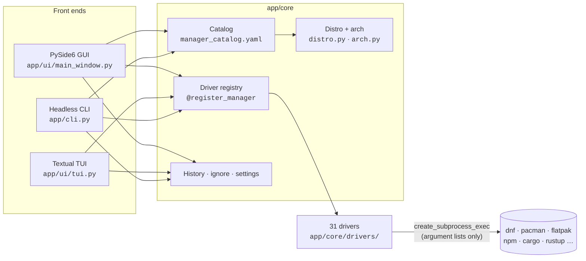

<div align="center">


# PolyGet

### One store for every package manager on your machine.

[](LICENSE)
[](https://www.python.org/)
[](https://doc.qt.io/qtforpython/)
[](https://textual.textualize.io/)
[](#-supported-package-managers)
[](#-testing)
[](#-design-principles)
[](ASAHI.md)

**[Why](#-why-polyget) · [Features](#-features) · [Managers](#-supported-package-managers) · [Quick start](#-quick-start) · [CLI](#-command-line) · [How it works](#-how-it-works) · [Principles](#-design-principles) · [Contributing](#-adding-a-driver)**

<br>


<sub>The Updates page on a real machine: every manager's pending updates in one list, grouped per manager, with the version bump colored by size (red major, yellow minor, green patch) and a bar that says how many picks will ask for your admin password.</sub>

</div>

---

## ❖ Why PolyGet

One machine runs Pacman. The other runs DNF. Flatpak doesn't care which. Neither does npm, Cargo,
Pipx, rustup, mise, or the twenty other language tools filling up your `~/.local`. Each has its
own commands, its own idea of "outdated", and its own way of failing quietly.

PolyGet puts them all behind **one dashboard, one search bar and one place to manage repos and
remotes**, so you stop asking "which package manager owns this again?" It comes in three forms
that share one driver layer:

| | Interface | Good for |
|---|---|---|
| 🖥️ | **PySide6 desktop app** (`python run.py`) | Daily use: review updates, browse the store, manage repos |
| ⌨️ | **Textual TUI** (`python run.py --tui`) | SSH sessions and headless boxes, with a polkit-aware sudo fallback |
| 🧾 | **Headless CLI** (`python run.py <command> --json`) | Scripts, cron jobs and AI coding agents |

It's built and used daily on two machines with different defaults: **CachyOS** (Arch-based) and
**Asahi Linux** (Fedora-based, ARM64). That's why the Pacman and DNF drivers are held to the same
standard.

---

## ✦ Features

### Keeping things current

- **One dashboard for updates.** Every outdated package from every active manager, grouped under
  a header per manager with its scan status. A failed scan shows as **failed**, never as "up to
  date", and has a **Retry** button for that manager only.
- **Batch upgrades that report what happened.** Select, press **Update**, and follow the live
  terminal overlay. Non-elevated managers (Flatpak, Pipx, npm, ...) upgrade **in parallel**.
  Elevated ones (DNF, Pacman, APT, Snap) run one at a time so you authenticate once each.
  **Only user-level** skips everything that would need your admin password.
- **Upgrades are verified.** After an upgrade, a rescan decides whether it worked. A tool that
  exits 0 without upgrading (like a dnf vendor-change skip) is reported as *not upgraded*, and a
  **Retry** re-runs just the failures.
- **Version Check.** Finds packages you have installed through more than one manager (say, pipx
  and pacman) where another manager has a newer version (`run.py newest`).
- **Skip, ignore, pin.** Hide one version until a newer one ships, ignore a package entirely, or
  allow a DNF vendor change for one package.
- **History.** An append-only log of what was upgraded, when, and whether it worked.
- **Tray and background scans.** Close to tray, scan every N hours, get a notification when new
  updates appear, and optionally start at login.

### Finding and installing software

- **Manager Store.** Search every backend at once, or browse AppStream categories that mix
  Flatpak with your distro's own packages. Installs always go through the driver that owns the
  package.
- **Review AUR build scripts first.** For AUR packages, PolyGet shows the PKGBUILD before
  anything builds, during install and upgrade (`run.py review -m aur PKG`).
- **Remove with a preview.** **Remove…** lists every package that would be removed along with it
  before anything runs.
- **Manager catalog.** The store also lists package managers you *don't* have yet (Zypper, Guix,
  Composer, Maven, ...) with one-click install commands for your distro and CPU architecture.
- **Blueprints.** Export your installed packages to a portable YAML file, diff it against another
  machine, and sync the differences either way, with version pinning.

### Under the hood

- **Repository management.** List, add, enable, disable and remove repos and remotes for DNF,
  APT and Flatpak, inside the app.
- **Debug Console.** A live stream of every package-manager command PolyGet runs. It can also
  write a JSONL log that Claude Code, Codex, Copilot or OpenCode can read without running
  PolyGet.
- **Keyring support.** The TUI can keep your sudo password in the OS keyring (Secret Service or
  KWallet), so it can use sudo when no polkit agent is running. You can remove it from Settings.
- **Tweakable UI.** UI scale from 75% to 200%, font size from 8 to 32 px, three sidebar header
  styles, three navigation styles, and a touch mode with 44 px+ tap targets.

### Keyboard shortcuts

| Shortcut | Action | | Shortcut | Action |
|---|---|---|---|---|
| `Ctrl+R` | Check for updates | | `F1` | Debug Console |
| `Ctrl+U` | Update selected | | `Esc` | Hide terminal overlay |
| `Ctrl+S` | Sync repositories | | `Ctrl+Q` | Quit |
| `Ctrl+Shift+U` | Cross-manager version scan | | | |

---

## ✦ Supported package managers

**31 drivers** work with your system today. The catalog lists **41 managers**, so the store can
offer the other 10 before they have a driver.

| Category | Driven today (31) | Catalog only (10) |
|---|---|---|
| **System** | DNF · Pacman · APT · AUR (paru/yay) · Firmware (fwupd) | Zypper · APK · XBPS · Portage · eopkg |
| **Universal** | Flatpak · Snap · Nix · Homebrew (macOS + Linuxbrew) · Distrobox | Guix |
| **Language/Dev** | npm · Yarn · pnpm · Bun · Deno · Pipx · uv · Poetry · Conda · Cargo · Rustup · Go · RubyGems · Bundler · Gradle · Mise · Dart Pub · Hex · cpanm · Julia · Fisher | Composer · NuGet · Maven · LuaRocks |

A few notes:

- **Bundler** and **Gradle** work per project. Register a directory with
  `python run.py projects add DIR` and PolyGet scans its `Gemfile` or Gradle wrapper.
- **Deno, Nix and Distrobox** can't report outdated packages, so the scan shows *can't check*
  instead of a misleading "up to date".
- **Firmware** goes through `fwupd`, so device firmware updates appear next to your packages.

---

## ✦ Quick start

```bash
git clone https://github.com/DaRipper91/PolyGet.git && cd PolyGet
python3 -m venv .venv
source .venv/bin/activate
pip install -r requirements.txt

python run.py         # desktop app
python run.py --tui   # terminal UI
```

To add PolyGet to your app launcher with its icon:

```bash
./scripts/install-desktop.sh            # installs the .desktop entry and icons into ~/.local
./scripts/install-desktop.sh --uninstall
```

**Requirements:** Linux, Python 3.10+, and whichever package managers you already use. PolyGet
finds them on its own.

---

## ✦ Command line

Any subcommand skips the GUI. Add `--json` to get exactly one JSON document on stdout. Progress and
child-process output go to stderr.

```bash
python run.py managers                  # which package managers this machine has
python run.py outdated                  # every pending update, grouped by manager
python run.py outdated -m npm --json    # one manager, as JSON
python run.py search ripgrep            # search every backend at once
python run.py newest                    # same package on two managers, one is newer
python run.py review -m aur paru-bin    # read the PKGBUILD before you build it
python run.py upgrade -m flatpak        # print the upgrade plan...
python run.py upgrade -m flatpak --yes  # ...then run it
python run.py history                   # what was upgraded, when, and whether it worked
```

<details>
<summary><b>All 19 subcommands</b></summary>

| Command | What it does |
|---|---|
| `managers [--all]` | Package managers found on this system |
| `outdated` | Available updates across managers |
| `installed` | Installed packages |
| `search QUERY` | Search package sources |
| `audit` | Known security advisories for installed packages |
| `repos` | Configured repositories and remotes |
| `upgrade` | Upgrade outdated packages (ignored ones are skipped) |
| `install` | Install packages with one manager |
| `remove` | Uninstall packages, previewing dependencies first |
| `review` | Print the build script (e.g. an AUR PKGBUILD) a package would run |
| `sync` | Refresh repository metadata |
| `history` | Show the upgrade history log |
| `ignore` | Manage packages excluded from upgrades |
| `projects` | Manage project directories scanned by Bundler and Gradle |
| `system` | Show the detected CPU architecture and distro family |
| `self-version` | Show each package manager's own version |
| `catalog` | List every cataloged manager, installed or not |
| `newest` | Packages installed on multiple managers with a newer version elsewhere |
| `debug` | Read or tail the structured debug log |

Use `-m/--manager NAME` (repeatable, case-insensitive) to limit a command to specific managers.

</details>

**Nothing changes your system until you say so.** `upgrade`, `install`, `remove` and `sync` only
print the exact commands they would run until you add `--yes`.

| Exit code | Meaning |
|---|---|
| `0` | OK |
| `1` | A manager or command failed (partial results are still printed) |
| `2` | Usage error: unknown or uninstalled manager, bad arguments |

---

## ✦ How it works



- Every driver subclasses `PackageManager` and is found automatically by the registry.
- Drivers are `async`. A failed query raises `DriverError` instead of returning an empty list, so
  "nothing found" and "the query broke" stay separate all the way up to the UI.
- Anything that differs by distro family or CPU architecture is decided in `app/core/distro.py`
  and `app/core/arch.py`, never inside a driver.
- The upgrade history (`~/.local/share/polyget/history.jsonl`) and ignore list
  (`~/.config/polyget/ignored_packages.json`) are shared by the GUI, TUI and CLI.

<details>
<summary><b>Project layout</b></summary>

```
PolyGet/
├── run.py                   # entry point → GUI, --tui, or CLI
├── app/
│   ├── main.py              # routes to the right front end
│   ├── cli.py               # headless argparse CLI with --json
│   ├── core/
│   │   ├── manager.py       # PackageManager base class, DriverError, registry
│   │   ├── drivers/         # one file per package manager (31)
│   │   ├── catalog.py       # Manager Store catalog loader
│   │   ├── data/manager_catalog.yaml
│   │   ├── distro.py        # the only place distro differences live
│   │   ├── arch.py          # CPU architecture detection
│   │   ├── coordinator.py   # runs scans across managers
│   │   ├── blueprint.py     # YAML export / diff / sync
│   │   ├── version_scan.py  # cross-manager newest-version scan
│   │   └── *_store.py       # history, ignore list, settings
│   └── ui/                  # PySide6 windows, sidebar, dialogs, Textual TUI
├── assets/                  # icons and .desktop entry
├── scripts/                 # launcher installer, icon renderer
├── docs/plans/              # dated design docs: the "why" behind each feature
└── tests/                   # pytest suite, fake managers only
```

</details>

---

## ✦ Design principles

> **No `shell=True`. Ever.**
> Every subprocess call uses `asyncio.create_subprocess_exec` with an argument list. This is what
> keeps a package name or search query from becoming shell injection. A `shell=True` in a PR is a
> critical bug, not a style nit.

> **Distro differences live in one place.**
> `app/core/distro.py`. A distro check anywhere else is a bug, even if it works on the machine it
> was written on.

> **Show what you *could* install.**
> The catalog exists so the Manager Store shows managers you don't have yet, not only the ones
> you do. Narrowing it to "installed only" would be a regression.

> **A loud failure beats a silent success.**
> A failed or hung check appears as an error in the UI. It is never reported as "up to date"
> because an exception was caught somewhere.

---

## ✦ Adding a driver

Ten managers in the catalog don't have a driver yet. To add one, put a file in
`app/core/drivers/` and decorate the class. The registry finds it automatically:

```python
from app.core.manager import PackageManager, register_manager, run_capture

@register_manager
class LuaRocksManager(PackageManager):
    name = "LuaRocks"
    category = "Language/Dev"

    def is_available(self) -> bool: ...
    async def check_updates(self) -> list[dict]: ...      # [{"name", "current", "new"}]
    async def list_installed(self) -> list[str]: ...      # raise DriverError on failure, never return []
    def get_upgrade_command(self, packages=None) -> list[str]: ...  # an argument list, never a string
```

Then set `has_driver: true` for its entry in `app/core/data/manager_catalog.yaml` and add a test
under `tests/` that uses fake command output. **Tests never call real package managers.**
`app/core/drivers/rustup.py` is a short, complete example to copy.

---

## ✦ Testing

```bash
pip install -r requirements-dev.txt
QT_QPA_PLATFORM=offscreen pytest -q      # 491 passed, 1 skipped in about 10 seconds
```

The suite runs headless and uses fake managers, so it passes on any Linux machine, including
those without Pacman or DNF. Driver behavior for those two is checked on real CachyOS and Asahi
hardware.

---

## ✦ Development with Claude Code

PolyGet is set up for AI-assisted development:

- **`CLAUDE.md`** covers the design rules in more depth, plus driver bugs that were fixed and
  shouldn't come back (Flatpak's `-j` flag, Pipx's fake PyPI lookup, Pacman's exit code 1 on
  "no updates").
- **The `polyget` skill** (`.claude/skills/polyget/`) teaches Claude Code the CLI. Ask "what's
  outdated?" or "which manager has ripgrep?" and it answers with `run.py ... --json`. It shows
  upgrades as a plan for you to approve and never runs them on its own.
- **The `rip-it-apart` audit** runs six subagents in order (recon → verify → bug hunt → strengths
  → critique → fix plan) and produces a cited audit of the codebase.
- **A cloud environment** (Ubuntu, with Flatpak, Pipx and headless Qt6) for driver and UI work on
  Claude Code on the web. It has no Pacman or DNF; those are tested on real Arch and Fedora
  hardware.

See also: [`ROADMAP.md`](ROADMAP.md) · [`ASAHI.md`](ASAHI.md) · [`BRANCHING.md`](BRANCHING.md) ·
[`docs/plans/`](docs/plans/)

---

<div align="center">

**MIT licensed** · see [`LICENSE`](LICENSE)


</div>
