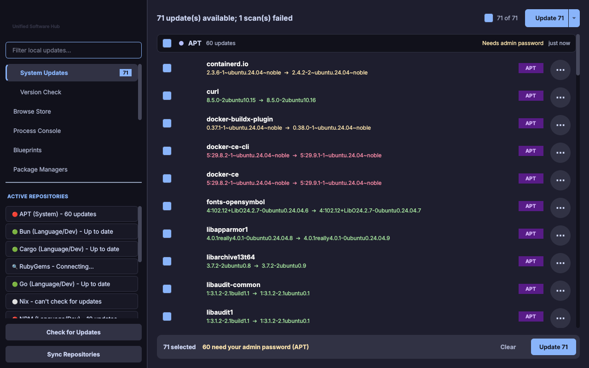
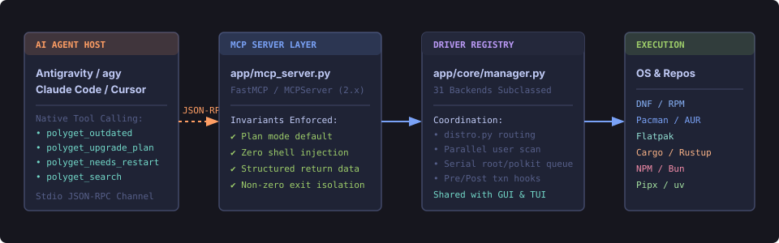
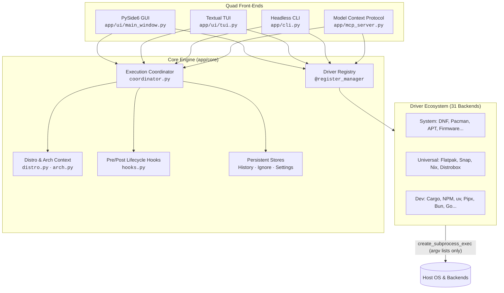

<div align="center">

<a href="https://github.com/DaRipper91/PolyGet">
  
</a>

<br/>

### Sovereign multi-ecosystem package management for Linux power users and autonomous AI agents.

[](LICENSE)
[](https://www.python.org/)
[](https://doc.qt.io/qtforpython/)
[](https://textual.textualize.io/)
[](#-headless-command-line)
[](docs/mcp-server.md)
[](#-supported-package-managers)
[](#-testing)
[](docs/architecture.md#1-zero-shelltrue-strict-invariant)
[](ASAHI.md)

<br/>

**[Why PolyGet](#-why-polyget) · [Interfaces](#-quad-interface-architecture) · [MCP Protocol](#-model-context-protocol-mcp-server) · [Supported Managers](#-supported-package-managers) · [Quick Start](#-quick-start) · [CLI Reference](#-headless-command-line) · [Architecture](#-architecture--invariants) · [Documentation](#-companion-documentation)**

<br/>



<sub>The Updates page on a physical system: every manager's pending updates in one unified list, grouped per manager, with semver version bumps colored by magnitude (red major, yellow minor, green patch) and explicit admin elevation warnings.</sub>

</div>

<p align="center">
  
</p>

## ❖ Why PolyGet

One machine runs **Pacman**. The other runs **DNF**. Flatpak doesn't care which. Neither does npm, Cargo, Pipx, rustup, uv, or the twenty other language runtimes filling up your `~/.local`. Each has its own CLI commands, its own idea of "outdated", and its own way of failing quietly.

PolyGet unifies them behind **one synchronized control plane, one global search engine, and one place to manage repositories and remotes**. You never have to ask *"which package manager installed this binary again?"*

<p align="center">
  
</p>

### Equal Parity Across Four Modalities

Every interface is a first-class citizen sharing the identical asynchronous driver registry ([`app/core/manager.py`](app/core/manager.py)):

| Modality | Invocation | Optimized For | Elevation & Safety |
|---|---|---|---|
| 🖥️ **Desktop GUI** | `python run.py` | Visual daily driver: review updates, semver magnitude colors, AppStream store, repo management | Graphical polkit prompts, serial root execution |
| ⌨️ **Terminal TUI** | `python run.py --tui` | Headless servers, SSH sessions, quick terminal maintenance | Keyring sudo integration ([`sudo_secret.py`](app/core/sudo_secret.py)) or polkit fallback |
| 🧾 **Headless CLI** | `python run.py <cmd> --json` | Shell scripts, pipelines, cron updates, terminal queries | Pure JSON stdout, progress on stderr, exit codes `0/1/2` |
| 🤖 **MCP Server** | `python run.py mcp` | Autonomous AI agents (**Antigravity / `agy`**, Claude Code, Cursor) | 9 schema-validated tools, dry-run plan mode by default |

---

## ✦ Model Context Protocol (MCP) Server

PolyGet features a native [Model Context Protocol (MCP)](docs/mcp-server.md) server running over `stdio` via `mcp.server.mcpserver`. Autonomous coding agents can inspect system packages, search registries, run CVE audits, and build non-destructive upgrade plans without brittle shell scraping.

<p align="center">
  
</p>

### Connecting to AI Agents

#### Antigravity CLI (`agy`)
Register the server into your agent's runtime with one command:
```bash
agy mcp add polyget /path/to/PolyGet/.venv/bin/python /path/to/PolyGet/mcp_server.py
```

#### Claude Code (`~/.claude.json`)
```json
{
  "mcpServers": {
    "polyget": {
      "command": "/path/to/PolyGet/.venv/bin/python",
      "args": ["/path/to/PolyGet/mcp_server.py"]
    }
  }
}
```

### Available MCP Tools
- `polyget_list_managers`: Enumerate active, available, and cataloged package managers.
- `polyget_check_outdated`: Query pending updates with version deltas across managers.
- `polyget_list_installed`: Inventory installed packages per manager.
- `polyget_search`: Cross-registry keyword query with error isolation.
- `polyget_audit`: Security vulnerability scans (`npm audit`, `cargo audit`, `pip-audit`).
- `polyget_list_repos`: List configured software mirrors and PPAs (DNF, Flatpak, APT).
- `polyget_needs_restart`: Detect post-upgrade reboot or service restart flags.
- `polyget_upgrade_plan`: Non-destructive dry-run upgrade planning returning exact `argv` command vectors.
- `polyget_history`: Query append-only transaction history logs.

Read the complete [MCP Server Documentation](docs/mcp-server.md) for full schema definitions and workflows.

<p align="center">
  
</p>

<p align="center">
  
</p>

## ✦ Supported Package Managers

**31 drivers** actively interface with system and user runtimes today. The catalog covers **41 managers**, allowing the store to surface installable backends before they have been installed locally.

| Category | Active Drivers (31) | Catalog / Installable (10) |
|---|---|---|
| **System** | DNF · Pacman · APT · AUR (`paru`/`yay`) · Firmware (`fwupd`) | Zypper · APK · XBPS · Portage · eopkg |
| **Universal** | Flatpak · Snap · Nix · Homebrew (Linuxbrew) · Distrobox | Guix |
| **Language/Dev** | Cargo · Rustup · uv · Pipx · Poetry · Conda · npm · pnpm · Yarn · Bun · Deno · Go · RubyGems · Bundler · Gradle · Mise · Dart Pub · Hex · cpanm · Julia · Fisher | Composer · NuGet · Maven · LuaRocks |

- **Project Scans**: Bundler and Gradle operate per-project via `python run.py projects add DIR`.
- **Query Transparency**: Tools that cannot query updates (e.g. Nix, Deno) report *unsupported*, never an erroneous "up to date".
- **Hardware Firmware**: Direct integration with `fwupd` surfaces motherboard and peripheral updates right alongside applications.

<p align="center">
  
</p>

<p align="center">
  
</p>

## ✦ Architecture & Invariants

PolyGet enforces rigorous systems programming contracts to guarantee environment safety:



### Key Architectural Invariants
1. **Zero `shell=True` (Strict Invariant)**: Every command executes via `asyncio.create_subprocess_exec` using explicit `argv` lists. Arbitrary package names or queries can never trigger shell injection.
2. **Distro Isolation**: Distro-specific rules live strictly in [`app/core/distro.py`](app/core/distro.py) and [`app/core/arch.py`](app/core/arch.py). Drivers are never permitted to make ad-hoc distro assumptions.
3. **Closed-Loop Verification**: After applying upgrades, PolyGet verifies that packages were genuinely updated via `still_outdated()`. Zero-exit no-ops (like DNF vendor-change skips) are flagged as failures.
4. **Elevation Serialization**: User-level package managers upgrade concurrently; elevated operations (DNF, Pacman, APT) serialize to protect system locks.
5. **Pre/Post Lifecycle Hooks**: Execute custom scripts (e.g. btrfs snapshots) before or after upgrades via `polyget hooks add pre -- btrfs subvolume snapshot ...`.

Read the comprehensive [System Architecture Invariants](docs/architecture.md) document.

---

## ✦ Quick Start

```bash
git clone https://github.com/DaRipper91/PolyGet.git && cd PolyGet
python3 -m venv .venv
source .venv/bin/activate
pip install -r requirements.txt

# Run any of the 4 interfaces:
python run.py         # 1. Desktop GUI (PySide6)
python run.py --tui   # 2. Terminal TUI (Textual)
python run.py outdated --json  # 3. Headless CLI
python run.py mcp     # 4. Model Context Protocol Daemon (stdio)
```

To install the desktop application launcher and icons into `~/.local`:
```bash
./scripts/install-desktop.sh
```

---

## ✦ Headless Command Line

Any subcommand routes to the headless CLI, bypassing Qt dependencies entirely. Passing `--json` outputs exactly one clean JSON document to `stdout`:

```bash
python run.py managers                  # Enumerate installed package managers
python run.py outdated                  # Check pending updates across all managers
python run.py outdated -m npm --json    # Filter by manager with structured JSON output
python run.py search ripgrep            # Search all registries concurrently
python run.py newest                    # Detect multi-manager duplicate installs
python run.py review -m aur paru-bin    # Inspect PKGBUILD before building
python run.py upgrade -m flatpak        # Print dry-run upgrade plan
python run.py upgrade -m flatpak --yes  # Execute planned upgrade
python run.py needs-restart             # Check if systemd/kernel requires a reboot
python run.py history                   # Audit past transaction logs
python run.py mcp                       # Start the stdio MCP server
```

<details>
<summary><b>All 20 Subcommands</b></summary>

| Subcommand | Description |
|---|---|
| `managers [--all]` | Package managers detected on this system |
| `outdated` | Query available package updates across managers |
| `installed` | List packages currently installed |
| `search QUERY` | Query package registries concurrently |
| `audit` | Scan installed packages for known security vulnerabilities |
| `repos` | View configured software repositories and mirrors |
| `upgrade` | Upgrade outdated packages (plan mode default; requires `--yes` to run) |
| `install` | Install packages through a specified manager |
| `remove` | Uninstall packages with dependency preview |
| `review` | Inspect user-submitted build scripts (e.g. AUR PKGBUILDs) |
| `sync` | Synchronize package repository metadata |
| `history` | Display the append-only upgrade/removal transaction log |
| `ignore` | Manage packages excluded from updates |
| `projects` | Manage local project directories (Bundler, Gradle) |
| `system` | Display detected OS distro family and CPU architecture |
| `self-version` | Query the underlying version of each package manager |
| `catalog` | List all 41 cataloged managers |
| `newest` | Flag packages installed on multiple managers with newer versions |
| `needs-restart` | Check if a reboot or daemon restart is required |
| `mcp` | Launch the Model Context Protocol (MCP) stdio daemon |

</details>

---

## ✦ Testing

PolyGet maintains 100% mocked, hardware-independent tests that run without physical displays or live network connections:

```bash
pip install -r requirements-dev.txt

# Run complete test suite headlessly
QT_QPA_PLATFORM=offscreen pytest -q

# Run focused suites
QT_QPA_PLATFORM=offscreen pytest tests/test_mcp_server.py
QT_QPA_PLATFORM=offscreen pytest tests/test_cli.py
```

---

## ❖ Companion Documentation

- [**Model Context Protocol (MCP) Guide**](docs/mcp-server.md): Integration guide for `agy`, Claude Code, and Cursor.
- [**System Architecture & Invariants**](docs/architecture.md): Subprocess invariants, coordination, and elevation rules.
- [**Adding a Driver Guide**](docs/guides/adding-a-driver.md): Step-by-step instructions for adding new backends.
- [**Contributing Protocol**](CONTRIBUTING.md): Multi-machine development and testing standards.
- [**Changelog**](CHANGELOG.md): Semantic release and version history.
- [**Branching Strategy**](BRANCHING.md): Multi-machine synchronization (`Asahi/BETA-FEATURES` & `CachyOS/BETA-FEATURES`).

---

<div align="center">

**MIT Licensed** · Developed on **Fedora Asahi Remix** (Apple Silicon M1) & **CachyOS** (Arch Linux)


</div>
