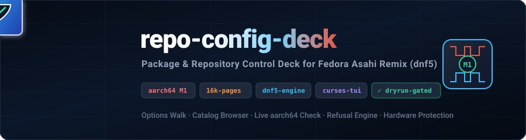

<p align="center">
  
</p>

<p align="center">
  
  
  
  
  
  
  
  
</p>

# repo-config-deck

> [!NOTE]
> **Bundled with [PolyGet](https://github.com/DaRipper91/PolyGet).**  
> Accessible directly via `polyget repo-deck`, `polyget repos --deck`, or by pressing `s` in `polyget tui`.

**The hardware-guarded package configuration & repository control deck for Fedora Asahi Remix on Apple Silicon.**

Managing package sources on Apple Silicon (M1/M2/M3) is not standard x86 Linux administration. Installing the wrong third-party repository can overwrite Asahi's custom Mesa GPU driver, wreck the 16k page-size kernel, pull non-functional x86_64 RPMs, or compromise package signature verification.

**`repo-config-deck`** provides a unified curses TUI ([asahi-deck.py](file:///home/daripper/Projects/repo-config-deck/asahi-deck.py)) and scripted CLI engine ([configure-dnf.sh](file:///home/daripper/Projects/repo-config-deck/configure-dnf.sh)) to manage both global [dnf.conf](file:///home/daripper/Projects/repo-config-deck/dnf.conf) settings and third-party [repos.catalog](file:///home/daripper/Projects/repo-config-deck/repos.catalog) sources through an uncompromising **Zero-Trust Dry-Run Gate**.

<table>
<tr>
<td width="25%" valign="top"><b>🛡️ Hardware Protection</b><br>Hard refusal rules prevent enabling repos that overwrite Asahi's Mesa stack, replace the 16k kernel, or bypass GPG.</td>
<td width="25%" valign="top"><b>⚡ DNF5 Speed &amp; Candy</b><br>10 parallel downloads, aggressive zchunk deltas, fastestmirror tuning, and vibrant terminal color schemes.</td>
<td width="25%" valign="top"><b>🎛️ Dual Control Engines</b><br>Interactive curses TUI with live aarch64 build checks, side-by-side diff review, plus a scripted CLI for automation.</td>
<td width="25%" valign="top"><b>🔒 Zero-Trust Dry-Run Gate</b><br>No change ever touches disk without passing an automated preflight dry run and user review first.</td>
</tr>
</table>

<p align="center"></p>

## 🧭 Navigation & Overview

- [🎨 Visual Design &amp; Ricing Assets](#-visual-design--ricing-assets)
- [📱 Pixel 10 Pro Native Termux Deck](#-pixel-10-pro-native-termux-deck)
- [🛡️ Apple Silicon Safety Directives](#-apple-silicon-safety-directives)
- [🎛️ Curses TUI Interface](#-curses-tui-interface)
- [🚀 Quick Start &amp; Installation](#-quick-start--installation)
- [📦 Curated Repository Catalog](#-curated-repository-catalog)
- [⚙️ DNF5 Performance &amp; Candy Configuration](#-dnf5-performance--candy-configuration)
- [🏗️ Architecture &amp; Dry-Run Engine](#-architecture--dry-run-engine)
- [🔄 Backup &amp; Disaster Recovery](#-backup--disaster-recovery)

<p align="center"></p>

## 🎨 Visual Design &amp; Ricing Assets

`repo-config-deck` ships with high-contrast, scalable SVG assets crafted for modern desktop ricing, terminal theming, and app launcher integration.

### 🎭 Desktop Launcher Icon Concepts

The repository maintains three distinct design concepts in [`assets/icons/concepts/`](file:///home/daripper/Projects/repo-config-deck/assets/icons/concepts/):

| Concept | Asset | Aesthetic &amp; Meaning | Status |
|:---:|:---:|---|:---:|
| **A** |  | **Shield &amp; Verified Package**: Fedora blue gradient shield (`#6095EB` → `#3C6EA5`), crisp dnf verification checkmark, and banded package crate. Focuses on security and integrity. | **Active System Icon** ([asahi-deck.svg](file:///home/daripper/Projects/repo-config-deck/asahi-deck.svg)) |
| **B** |  | **Apple Silicon SoC &amp; Micro-traces**: Dark slate silicon substrate (`#2C3E50`) with neon cyan circuit paths and package load. Symbolizes native Apple Silicon hardware acceleration. | Alternative Concept |
| **C** |  | **Triple Control Deck**: Three fanned cards representing the `[Options]`, `[Repos]`, and `[Review]` inspection tabs with a centered package delivery check. | Alternative Concept |

### 🍭 Terminal Candy &amp; Color Grading

`repo-config-deck` tunes [dnf.conf](file:///home/daripper/Projects/repo-config-deck/dnf.conf) with a custom DNF5 high-visibility color scheme:

* 🟢 **Available Reinstall / Local Update:** `bold,green` (`#10B981`)
* 🔵 **Available Upgrades / Install:** `bold,cyan` &amp; `bold,blue` (`#38BDF8` / `#6095EB`)
* 🟣 **Remote Upgrades / Search Matches:** `bold,magenta` (`#A855F7`)
* 🔴 **Installed Package Mutations:** `dim,red` for clear demotion awareness

<p align="center"></p>

## 📱 Pixel 10 Pro Native Termux Deck

`repo-config-deck` includes a dedicated hardware-tuned native bundle for the **Google Pixel 10 Pro** (`da-pixel-10-pro`):

- **SoC & Platform:** Google Tensor G5 (`blazer`, aarch64), Android 17 non-root Termux userland with Shizuku (`rish`).
- **Interactive Control Deck:** Launch [pixel-deck.py](file:///root/Projects/repo-config-deck/pixel-deck.py) (symlinked to [termux-deck.py](file:///root/Projects/repo-config-deck/termux-deck.py)) with options walk, category filtering, search, and diff review.
- **Headless & Scripted CLI:** [configure-apt.sh](file:///root/Projects/repo-config-deck/configure-apt.sh) with Zero-Trust Dry-Run Gate.
- **Memory Ceiling Preservation:** Configures `APT::Install-Recommends "false"` to safeguard the ~2.5–3.0 GB userland headroom from memory exhaustion.
- **Flash Storage Optimization:** Automatically unlinks downloaded `.deb` packages via `APT::Clean-Installed "true"` and strips language indexes with `Acquire::Languages "none"`.
- **Zero-Trust Safety:** Enforces `Acquire::AllowInsecureRepositories "false"`; refuses unverified raw PPAs and x86_64 binaries.

```bash
# Launch interactive Termux control deck
python3 pixel-deck.py

# Run dry run inspection
./configure-apt.sh
```

<p align="center"></p>

## 🛡️ Apple Silicon Safety Directives

On Fedora Asahi Remix, standard Linux assumptions can brick hardware acceleration or render the system unbootable. `repo-config-deck` programmatically enforces strict refusal gates:

| Guardrail | Target | Risk Avoided |
|---|---|---|
| **Mesa Replacement Refusal** | `terra-mesa`, `negativo17-multimedia` | Asahi relies on a specialized downstream Mesa driver for Apple AGX GPUs. Upstream or third-party Mesa packages break hardware acceleration and crash Wayland. |
| **Protected Boot Kernel** | `@asahi/kernel`, `asahi-u-boot`, `asahi-branding` | The Apple Silicon bootloader chain requires 16k kernel builds and specific device-tree binaries. They can never be disabled or purged. |
| **Signature Enforcement** | `gpgcheck=True`, no `--nogpgcheck` | Package signature verification is strictly enforced across all mirrors. Turning off GPG checks is permanently blocked by the validator. |
| **Architecture Verification** | `google-chrome`, `microsoft-edge`, `steam` | Refuses proprietary x86_64-only repositories that ship no aarch64 binaries. Recommends native builds (e.g., native Chromium, Flatpak Steam via FEX). |

<p align="center"></p>

## 🎛️ Dual Control Engines: TUI &amp; CLI (Hybrid Architecture)

`repo-config-deck` features a resilient hybrid architecture designed for Apple Silicon environments. When running inside capable terminal emulators (Konsole, Ghostty, Alacritty), it opens the visual curses TUI. When launched over SSH, serial consoles, tmux, or non-interactive pipelines (Docker, scripts), it automatically degrades gracefully to a dependency-free ANSI CLI engine without crashing.

### 1. Interactive Curses TUI (`--tui`)

Launch the visual deck via [asahi-deck.py](file:///home/daripper/Projects/repo-config-deck/asahi-deck.py):

```bash
asahi-deck --tui --live
```

```text
  ASAHI CONTROL DECK  │  [aarch64 · 16K]  │  host: asahi  │  target: /etc/dnf/dnf.conf    Mode: grouped │ Live: on
 ◆ 1 Options  ◇ 2 Repos  ◇ 3 Review & Diff                                          [A Apply]  [? Help]  [Q Quit]
Category: [All] [Official] [Dev & Tools] [AUR/Prebuilt] [Desktop] [Security]                ● 2 changes pending
╭─ Repository Catalog ─────────── [28 repos] ─╮ ╭─ Repo Inspector: [asahi-kernel] ────────── [L Live Probe] ─╮
│  Status     Repository Name         Category │ │ Repository: [asahi-kernel]                                  │
├──────────────────────────────────────────────┤ │ Category: Official & Core Overlays   Kind: copr             │
│  [ON]       asahi-kernel            Official │ │ Status: REQ   Top Packages: kernel-16k (Asahi kernel)       │
│  [ON]       asahi-branding          Official │ │ Repo Identifiers: group_asahi:kernel                        │
│  [ON]       rpmfusion-free          AUR/Preb │ │                                                             │
│  [OFF]      copr-lazygit            Dev & To │ │ Description:                                                │
│  [REFUSED]  terra-mesa              Refused  │ │ Asahi Linux kernel-16k package builds for Apple Silicon.    │
│  [REFUSED]  google-chrome           Refused  │ │                                                             │
│  [OFF]      tailscale               Security │ │ MANDATORY SYSTEM COMPONENT:                                 │
│  [ON]       terra                   AUR/Preb │ │ Required for Fedora Asahi Remix operations. Deactivation    │
│  [REQUIRED] fedora                  Official │ │ is permanently locked.                                      │
╰──────────────────────────────────────────────╯ ╰─────────────────────────────────────────────────────────────╯
ℹ Click rows or press Enter to edit. Tab switches panes. ? opens Help.
[Tab] Tabs  │  [↑/↓] Move  │  [Enter] Edit/Toggle  │  [U] Unset  │  [/] Search  │  [D] Review  │  [A] Apply  │  [?] Help  │  [Q] Quit
```

#### Keybindings & Controls
* **`Tab` / `1`, `2`, `3`**: Cycle or jump directly between `[1 Options]`, `[2 Repos]`, and `[3 Review & Diff]` tabs.
* **`↑ / ↓`**: Navigate items in the active table with full row cursor highlight.
* **`PgUp / PgDn` & `Home / End`**: Fast page scrolling and jumps.
* **`Enter` / `Space`**: Edit option value (opens clean modal prompt or toggles booleans) or toggle repository.
* **`← / →`**: Cycle category filter chips (`Official`, `Dev & Tools`, `Desktop`, `AUR/Prebuilt`, `Security`, etc.).
* **`/`**: Instant modal search across settings, repo names, IDs, and descriptions (Esc to clear).
* **`U`**: Revert an option to its built-in default (comments it out in `dnf.conf`).
* **`L`**: Probe live `aarch64` build availability for the selected repository.
* **`J / K`**: Scroll the inspector detail card.
* **`Review Tab`**: High-contrast syntax-highlighted diff (additions green, deletions red, hunks cyan) with a visual progress bar (`[████████░░] 80%`). Scroll to the bottom to verify and unlock the dry-run gate:
  `[✓ REVIEW VERIFIED — DRY-RUN GATE UNLOCKED — PRESS [A] TO APPLY]`.
* **`? / F1`**: Centered floating modal overlay with keyboard shortcuts and safety rules.
* **`Q`**: Quit with confirmation modal if unsaved changes exist.

### 2. Robust Command-Line Engine (`--cli`)

For headless systems, SSH logins without proper terminfo databases, or simple keyboard-first terminal workflows:

```bash
# Interactive ANSI CLI menu
asahi-deck --cli

# Direct step-by-step options walk
asahi-deck --cli --mode single

# Direct batch query and mutations (no TTY required)
asahi-deck --list
asahi-deck --list-options
asahi-deck --enable tailscale docker-ce --apply -y
asahi-deck --set max_parallel_downloads=12 defaultyes=True --apply -y
asahi-deck --plan

<p align="center"></p>

## 🚀 Quick Start &amp; Installation

### 1. Interactive First Run

Clone and verify your system configuration without making any changes:

```bash
git clone https://github.com/DaRipper91/repo-config-deck.git
cd repo-config-deck
chmod +x configure-dnf.sh

# 1. Inspect active and cataloged repositories
./configure-dnf.sh list

# 2. Walk options and repos with live aarch64 build validation
./configure-dnf.sh --live

# 3. Apply reviewed changes through the dry-run gate
./configure-dnf.sh apply
```

### 2. Desktop Application Integration

Install `repo-config-deck` directly into your KDE Plasma / GNOME app drawer using [install.sh](file:///home/daripper/Projects/repo-config-deck/install.sh):

```bash
# User-mode installation into ~/.local (no root required)
bash install.sh --user

# System-wide installation into /usr/local
sudo bash install.sh --system
```

* Deploys the `asahi-deck` executable to `~/.local/bin/asahi-deck`.
* Installs the vector icon [asahi-deck.svg](file:///home/daripper/Projects/repo-config-deck/asahi-deck.svg) into `hicolor/scalable/apps/`.
* Registers the `.desktop` launcher with absolute paths so it opens in Konsole or your configured terminal emulator.

<p align="center"></p>

## 📦 Curated Repository Catalog

The catalog ([repos.catalog](file:///home/daripper/Projects/repo-config-deck/repos.catalog)) organizes vetted repositories into functional tiers:

| Category | Key Repositories | Notes |
|---|---|---|
| **Official &amp; Core** | `fedora`, `updates`, `asahi-kernel`, `asahi-branding` | Core OS feeds. Marked `required: yes` and protected against deactivation. |
| **Desktop &amp; Media** | `rpmfusion-free`, `rpmfusion-nonfree`, `flathub` | Essential codecs, hardware-accelerated playback (`ffmpeg`), and desktop software. |
| **Dev &amp; Toolchains** | `docker-ce`, `copr:atim/lazygit`, `gh-cli`, `terra` | Development stacks validated for ARM64 code generation. |
| **Security &amp; Infra** | `tailscale`, `1password`, `yubico` | Signed vendor repos verified for Apple Silicon connectivity. |
| **Refused / Blocked** | `terra-mesa`, `negativo17-multimedia`, `google-chrome` | Permanently refused due to Mesa clobbering or missing aarch64 builds. |

<p align="center"></p>

## ⚙️ DNF5 Performance &amp; Candy Configuration

[dnf.conf](file:///home/daripper/Projects/repo-config-deck/dnf.conf) configures high-performance package downloads tuned for Apple Silicon SSD architectures:

```ini
[main]
# Safety
gpgcheck=True
installonly_limit=3
protect_running_kernel=True
clean_requirements_on_remove=True
best=False
skip_if_unavailable=True

# Speed & Concurrency
max_parallel_downloads=10
max_downloads_per_mirror=3
fastestmirror=False
metadata_expire=43200
zchunk=True
keepcache=False
install_weak_deps=True
timeout=30

# Visual Styling & Usability
defaultyes=True
color_list_available_upgrade=bold,cyan
color_list_available_downgrade=dim,magenta
color_list_available_reinstall=bold,green
color_list_available_install=bold,blue
color_update_installed=dim,red
color_update_local=dim,green
color_update_remote=bold,magenta
color_search_match=bold,magenta
```

<p align="center"></p>

## 🏗️ Architecture &amp; Dry-Run Engine

The deck ensures system modifications are deterministic, staged, and verifiable:

```mermaid
flowchart TD
    subgraph Inputs [Configuration Inputs]
        C[repos.catalog]
        D[dnf.conf Template]
        S[/etc/dnf/dnf.conf]
    end

    subgraph Interface [Control Interface]
        TUI[asahi-deck.py / Curses]
        CLI[configure-dnf.sh / Bash]
    end

    subgraph Verification [Zero-Trust Dry-Run Gate]
        Val[Apple Silicon Refusal Validator]
        Live[--live aarch64 API Prober]
        Stage[Staged Config ~/.local/state/configure-dnf/]
        Diff[Unified Diff Inspector]
        Gate[lib/dryrun-gate.sh]
    end

    subgraph Target [Production System]
        Bak[/etc/dnf/dnf.conf.bak-stamp]
        LiveConf[/etc/dnf/dnf.conf]
        LiveRepos[/etc/yum.repos.d/*.repo]
    end

    C & D & S --> Interface
    TUI & CLI --> Val --> Live --> Stage --> Diff --> Gate
    Gate -- Dry Run OK & Approved --> Bak --> LiveConf & LiveRepos
```

<p align="center"></p>

## 🔄 Backup &amp; Disaster Recovery

State directories and rollback backups are preserved automatically in `~/.local/state/configure-dnf/`:

* **Configuration Backups:** Every apply creates a timestamped snapshot:
  ```bash
  sudo cp /etc/dnf/dnf.conf.bak-<timestamp> /etc/dnf/dnf.conf
  ```
* **Repository Deletion Staging:** Removed `.repo` definitions are moved to state backup before unlinking.
* **Package Transaction Rollback:** Revert bulk package installations using DNF5 transaction history:
  ```bash
  sudo dnf history undo <transaction-id>
  ```

---

<p align="center">
  <sub>Built for <b>Fedora Asahi Remix</b> on Apple Silicon (M1/M2/M3). Maintained by <a href="https://github.com/DaRipper91">DaRipper91</a>.</sub>
</p>
