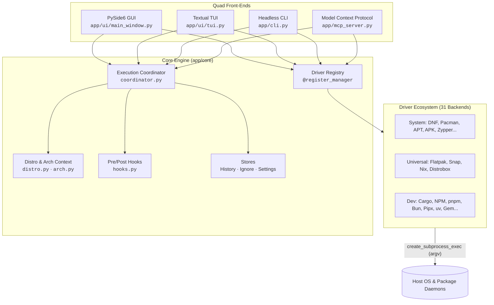

# System Architecture & Invariants

PolyGet unifies heterogeneous package managers across Linux distributions into four synchronized interfaces sharing one single-source-of-truth core.

---

## ❖ Architectural Invariants

Every contribution and refactor in this codebase must adhere to four non-negotiable invariants:

### 1. Zero `shell=True` (Strict Invariant)
Subprocess execution is exclusively handled via `asyncio.create_subprocess_exec` passing validated argument lists (`list[str]`). Package names, version strings, repository URLs, and search queries must never be formatted into shell command strings. This guarantees zero possibility of shell injection vulnerabilities.

### 2. Single-Source Distro Logic
Distro-family differences (Fedora/RHEL vs Arch vs Debian/Ubuntu) and architecture gates (x86_64 vs aarch64, 4KB vs 16KB kernel page sizes) are strictly quarantined in [`app/core/distro.py`](file:///home/daripper/Projects/PolyGet/app/core/distro.py) and [`app/core/arch.py`](file:///home/daripper/Projects/PolyGet/app/core/arch.py). Individual package manager drivers must never guess their environment through ad-hoc checks.

### 3. Closed-Loop Verification
Several system package managers exit with status `0` even when no changes took place (such as when upstream package vendors conflict or dependencies are skipped). PolyGet requires post-upgrade and post-removal verification checks (`still_outdated()` / `still_installed()`). If an upgrade transaction exits `0` but the package remains at the old version, the step is marked as a failure.

### 4. Elevation Serialization
User-space managers (`Cargo`, `NPM`, `Pipx`, `uv`, `Flatpak --user`) can run safely in parallel. Root and polkit-governed managers (`DNF`, `Pacman`, `APT`) require serialized execution to prevent package database lock contention (`/var/lib/rpm/.rpm.lock` or `/var/lib/pacman/db.lck`).

---

## ✦ System Topology

---

## ✦ Multi-Machine Development Workflow

PolyGet is actively developed across two distinct physical machines that feed one stable line:
1. **Asahi Linux (Fedora 44 Remix aarch64)**: Apple Silicon M1 (16KB page size). Owns the branch `Asahi/BETA-FEATURES`.
2. **CachyOS (Arch Linux x86_64)**: Custom kernel desktop. Owns the branch `CachyOS/BETA-FEATURES`.

Promotions to `master` occur only after changes are verified and clean across both environments. Read [`BRANCHING.md`](file:///home/daripper/Projects/PolyGet/BRANCHING.md) for full branch synchronization rules.
